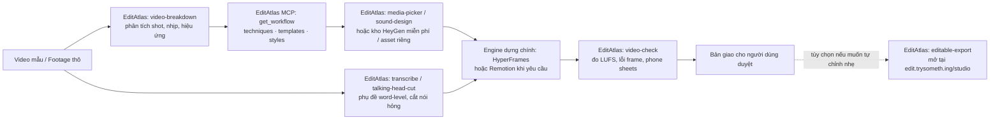

# EditAtlas — bộ Instruction tra cứu

Nguồn: website & docs `edit.trysometh.ing` (`docs/mcp`, `docs/templates`, `docs/agent-usage`, `docs/api`, `skills`, `studio`, `animation-styles`, `terms`, `privacy`), MCP server `https://edit.trysometh.ing/mcp` (15 tool) và repo `EditAtlas/skills` (Apache-2.0, v0.27.0, 7 skill).

Trạng thái: **bộ tri thức + công cụ bổ trợ** (đã kiểm chứng probe MCP và smoke `video-check`/`video-breakdown` trên clip mẫu 3 giây; chưa kiểm chứng đầy đủ trên mọi quy trình sản xuất dài). **HyperFrames** là công cụ dựng mặc định; **Remotion** dùng khi yêu cầu; EditAtlas bổ trợ khâu phân tích reference, tra kỹ thuật, tìm SFX/nhạc/B-roll, cắt talking head/transcribe, QA bản xuất và xuất gói chỉnh nhẹ Studio.

## Đọc gì khi nào

| Tình huống | Mở |
| --- | --- |
| Cài đặt, yêu cầu môi trường, bản quyền SFX/nhạc/B-roll, riêng tư, telemetry | [[knowledge/editatlas/01-setup-quyen-va-gioi-han]] |
| Nên dùng EditAtlas vào việc nào, phối hợp với HyperFrames/Remotion, khi nào KHÔNG dùng | [[knowledge/editatlas/02-ung-dung-trong-stack-sena]] |
| Chi tiết 15 tool MCP, 11 `video_type`, templates/styles/bundles và REST API | [[knowledge/editatlas/03-mcp-va-rest-api]] |
| Chi tiết 7 EditAtlas skills (script, yêu cầu, lưu ý) và EditAtlas Web Studio | [[knowledge/editatlas/04-7-skills-va-studio]] |

## 10 điều không được quên

1. **EditAtlas không giữ footage và không render trên cloud:** mọi xử lý video/âm thanh diễn ra cục bộ trên máy người dùng; MCP chỉ trả về kiến thức, kỹ thuật, template/style và link tải media.
2. **Đọc đúng skill gốc trước khi chạy bước tự động:** 7 skill (`video-breakdown`, `video-check`, `sound-design`, `media-picker`, `transcribe`, `talking-head-cut`, `editable-export`) đều có sẵn script Python/FFmpeg.
3. **Bắt đầu edit qua MCP → gọi `get_workflow` trước** (kèm `video_type` khi đã biết loại video) để lấy cấu trúc, nhịp và kỹ thuật khởi điểm; luôn kiểm tra file thật trước khi chọn hướng.
4. **Dịch sang tiếng Anh cho `search_music` (2–4 từ), `search_videos`, `search_photos`; `search_sfx` dùng được cả tiếng Việt lẫn tiếng Anh.**
5. **Rủi ro bản quyền SFX (rất quan trọng):** EditAtlas **không sở hữu toàn bộ 2.278 SFX và không cấp license bảo đảm** (*no licence, no warranty*). Với dự án thương mại/quảng cáo/client, cần báo rõ rủi ro hoặc ưu tiên nguồn có bản quyền rõ ràng (như kho HeyGen miễn phí hoặc asset riêng).
6. **Bản quyền nhạc & stock (Pixabay/Pexels):** luôn giữ `author` và `credit_url`; với nhạc YouTube cần cảnh báo `has_youtube_content_id` (kể cả khi `false` vẫn lưu tên bài + tác giả + `mp3_url`); link ảnh Pixabay hết hạn sau ~1 ngày nên tải sớm khi chọn.
7. **Không tự gọi `send_feedback`:** dữ liệu gửi qua `send_feedback` có thể được EditAtlas dùng để huấn luyện/kiểm thử AI model. Chỉ gửi khi người dùng yêu cầu rõ và tuyệt đối không kèm thông tin khách hàng/PII.
8. **Không đưa tên người, khách hàng hay dữ liệu nhạy cảm vào từ khóa tìm kiếm MCP:** EditAtlas lưu lịch sử query tìm kiếm trong 60 ngày.
9. **Chạy script skill kèm `EDITATLAS_TELEMETRY=0`** để tắt tín hiệu thống kê (`skill, version, result, seconds`).
10. **Kiểm chứng thật, không tin riêng prompt hay chỉ số:** chính EditAtlas xác nhận prompt chưa có editor chuyên nghiệp thẩm định toàn bộ, hướng dẫn Remotion/Three.js/Blender chưa chạy thử, và SFX mới đo bằng máy. Luôn mở ảnh frame ra nhìn và nói rõ phần âm thanh Sena chỉ đo bằng máy chứ chưa nghe.

## Vị trí của EditAtlas trong luồng dựng của Sena

## Giới hạn và điểm chưa kiểm chứng

- Chưa kiểm chứng đầy đủ mọi skill trên job sản xuất thật dài (talking head tiếng Việt dài, footage 4K, mix SFX phức tạp, `editable-export` trên nhiều trình duyệt).
- Gói nặng tùy chọn (`faster-whisper` cho `transcribe`/`talking-head-cut` và `playwright` + `cryptography` cho `editable-export/scripts/render.py`/`share.py`) chỉ cài khi người dùng có nhu cầu và đồng ý.
- 7 skill đang ở trạng thái **beta** (`v0.27.0`); version thật của từng skill nằm trong dòng `"This is <name> <version>"` ở đầu mỗi `SKILL.md`.
