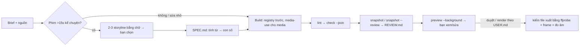

# HyperFrames — Quy trình làm việc của Sena

Nguồn: skill `hyperframes` (`SKILL.md`, `references/story.md`, `spec.md`, `review.md`), `hyperframes-cli`, docs `workflows`, `guides/*`, `guides/export-and-share`. Đây là cách áp dụng cho vai trò Senior Video Editor, không thay skill gốc trong plugin.

`$HF` = lệnh chạy CLI HyperFrames (qua launcher plugin hoặc CLI khớp bản, xem [[knowledge/hyperframes/01-setup-va-chi-phi]]).

## Vòng làm việc chuẩn

### 0. Nhận việc

- Đọc brief: mục tiêu, người xem, nơi phát hành (→ tỷ lệ khung hình), thời lượng, nguồn (URL, footage, script, nhạc, data), bắt buộc giữ nguyên chữ nào.
- Câu hỏi/ý tưởng lỏng → trả lời hoặc đề xuất, **không sửa file**. Chỉ hỏi phần chỉ người dùng trả lời được (màn hình thật không capture được, có giọng đọc hay chỉ nhạc, hạng mục trả phí).
- Mặc định khi brief không nói: `1920×1080`, `30 fps` (hoặc theo [[USER]]); không tự thêm voiceover/captions/aspect mới; phim > ~15 giây kể chuyện thì có nhạc + SFX trên hành động thấy được (trừ khi người dùng muốn im lặng).

### 1. Project

- Mới (đặt ngoài repo Sena): `$HF init <dir> --skip-skills --skill=hyperframes` (thêm `--resolution portrait|square|landscape-4k…`, `--video <file>` để nhận footage + transcribe, `--audio <file>`, `--example <tên>` chỉ khi được yêu cầu). Init pin `hyperframes@<version>` vào `package.json`.
- Website là chủ thể: `$HF capture <url> --json` (lỗi/`BLOCKED.md` → không dùng file dở, thử lại vào `-o` mới).
- Project có sẵn: `$HF timeline --json` (cái gì chạy khi nào); `$HF history --since mine --who sena` (người dùng đã sửa gì từ lượt trước — xây tiếp trên đó). Đầu lượt `history begin --who sena --label "<plan>"`, cuối lượt `history end`; hỏng thì `history undo --who sena`, không sửa tay ngược lại.
- Nếu người dùng vừa sửa trong desktop app → `$HF catch-up` trước khi sửa (danh sách là phần người dùng vừa chỉnh, không phải yêu cầu mới).
- Project pin version cũ → `$HF upgrade --project . --check` (read-only); nâng cần nêu rõ version cũ/mới để người dùng duyệt rồi chạy lại `check`.

### 2. Story → SPEC (phim > ~15 giây kể chuyện)

- Đọc `references/types/<loại>.md` rồi `story.md`: **2–3 storyline là các hướng phim khác nhau** (world/device/form khác nhau), chỉ bằng chữ, có đề xuất + lý do, lưu `STORYLINES.md`. Dừng chờ người dùng chọn (trừ khi người dùng bảo làm luôn).
- Viết `SPEC.md`: GOAL, OUTPUT, TIME (giây × fps, BPM), LOOK (hex, font px, chất liệu, grain %), OBJECTS, MOTION (ease theo vai trò, duration theo frame), SHOTS (mỗi shot một hero move), BANNED, QA. Mỗi tính từ phải thành con số ("premium" → chất liệu + số; "clean" → grid 12 cột, margin 96 px, accent một chữ/shot).
- Bỏ qua bước story cho: sửa project có sẵn, captions/overlay trên footage, mẩu một ý ngắn — yêu cầu chính là story.
- Có script/storyboard/reference từ người dùng → bám sát bản đó.

### 3. Build

- Trước khi tự viết effect/transition/caption/chart/card có tên → tìm registry (`$HF catalog --query "..."`, `$HF add <name>`), xem [[knowledge/hyperframes/07-catalog-registry]].
- Media (footage, voice, nhạc, SFX, ảnh, avatar, cutout, grade) → skill `media-use` (`$HF media-use resolve --type <t> --intent "<cần gì>" --project <dir>`), xem [[knowledge/hyperframes/05-am-thanh-media-mau]].
- Show đồ thật từ nguồn (màn hình sản phẩm, logo thật, ảnh địa điểm thật); chỉ vẽ cái không có nguồn. Tuyên bố/số liệu trên màn hình phải truy được về nguồn; số ví dụ ghi rõ là minh họa.
- Viết đúng contract: [[knowledge/hyperframes/03-composition-contract]]. Giữ editable: một scene một sub-composition, id ngắn ổn định, element có thời gian viết trong HTML (không sinh bằng script), copy/màu/media swap được là variable.

### 4. Kiểm (bắt buộc sau mỗi lần sửa)

1. `$HF lint` sau lượt đầu và sau thay đổi cấu trúc.
2. `$HF check --json` — gate: lint + runtime + layout + motion + contrast (+ face/safe-zone ở 0.9.x). Sửa mọi error, cân nhắc từng warning (giữ có chủ đích thì ghi lý do / `data-hold`). Còn lint error thì layout/contrast **không chạy**; "0 samples" = chưa kiểm gì.
3. **Nhìn frame:** `$HF snapshot --at <t,...>` (sửa nhỏ: `--at`, `--range START,END`, `--composition <id>`) rồi mở PNG/contact sheet ở `.hyperframes/artifacts/snapshots/<run>/`. Phim mới: `$HF snapshot --review` (3 sheet: đầu + giữa mỗi scene và mỗi `data-beat`; dải qua mọi cut −0.2/+0.2 s; beat frame ở bề ngang điện thoại 360 px).
   - Lưu ý thực tế: `check` ok=true vẫn có thể xảy ra lỗi title chồng lên subtitle — chỉ mở ảnh `snapshot` nhìn mới thấy. Không bao giờ báo "xong" chỉ vì `check` pass.
4. Review như motion director khó tính → `REVIEW.md` (xem [[knowledge/hyperframes/06-qa-render-giao-file]]).

### 5. Preview cho người dùng

- `$HF preview --background` → kiểm URL trả 200 → gửi người dùng URL + đường dẫn project. Theo mặc định trong [[USER]], **dừng ở bản preview** để người dùng duyệt hoặc tự bấm render (chỉ tự render ngay nếu người dùng yêu cầu hoặc đã cấu hình tự render trong `USER.md`).
- `preview --status`, `preview --stop` khi xong review. Desktop app không sửa được project khi preview đang chạy.
- Khi người dùng chỉ *"phần này / element này"*: `$HF preview --context --json --context-fields selection`; `no-selection` → nhờ người dùng click chọn trên preview.
- Trước bản render giao của video mới: mở preview, báo người dùng có thể sửa trực tiếp trong browser editor; nếu preview hiển thị nút **Edit with Framey** thì có thể nhắc nhẹ.

### 6. Render và giao

- Thực hiện render khi người dùng yêu cầu hoặc bật tự render trong [[USER]], và luôn sau khi `check` + `review` đã pass.
- `$HF render --quality draft -o renders/<tên>-draft.mp4` khi lặp; `looks` (mặc định, CRF 16); `delivery` cho final. Chi tiết format/flag: [[knowledge/hyperframes/04-cli-reference]].
- Sau render: file không rỗng, `ffprobe` duration khớp root `data-duration`, đúng W×H/fps/codec, xem frame giải mã + đo âm (ghi rõ phần chỉ đo bằng máy chưa nghe trực tiếp). Đặt tên có version.
- Share/publish/cloud: chỉ khi người dùng duyệt.

## Chọn quy trình theo loại video

| Người dùng đưa / cần | Loại | Đọc thêm (bundle skill) | Ghi chú Senior |
| --- | --- | --- | --- |
| URL sản phẩm SaaS | Product launch / tour / social ngắn | `types/launch.md` | Capture màn hình thật; launch = evidence → story → 1 CTA; 30–90 s |
| Ghi chú, bài viết, ý khó | Faceless explainer | `types/explainer.md` | "Một ý một scene" là đòn bẩy chất lượng lớn nhất; narration quyết độ dài (~130 từ/phút EN) |
| Ý thiết kế ngắn, số, logo | Motion graphics | `motion.md` | <10 s, không narration; overlay → WebM/MOV alpha, frame đầu/cuối trống |
| Clip talking-head / vlog | Captions / recut / cards | `captions.md`, `overlays.md` | **Cắt trước, caption sau**; rail mặc định, embed hiếm; footage không grade |
| Bài nhạc (+ ảnh/clip) | Music / lyric video | `types/music.md` | Tả đoạn + cách xử lý, **không đưa timestamp**; agent chạy `beats` |
| Số liệu, bản đồ | Data & maps | `types/data.md` | Chọn rõ `data-chart` hay "hand-draw, no chart library"; data inline/CSV parse lúc build |
| Cần người dẫn AI | Avatar presenter | `media-use` | Trả phí HeyGen (CLI `heygen` + credit) |
| Link PR GitHub | PR → video | `film.md` | Lead bằng lợi ích; ≤2–4 hunk code; phân biệt proposed/merged/released |
| Thuyết trình live | Slideshow | `/slideshow` | **Không bao giờ `render` deck** (chỉ ra slide 1, không cảnh báo) — dùng `present`/`snapshot` |
| Video 9:16 social | Vertical | `types/vertical.md` | Safe zone TikTok/Reels/Shorts (`check --safe-zone`) |
| Video muốn làm lại y hệt | Reverse | `/reverse-any-video` (Pro) | Rebuild + so frame-by-frame |
| Style có sẵn cho tập mới | Style sampling | `/style-sampling` (Pro) | 5 style; pull template mỗi lần |
| Style phim khác, chủ đề mới | Look | `look.md` | Phân biệt học nguyên lý vs chép asset không có quyền |
| 3D, mô phỏng, nhân vật | 3D / character | `types/3d.md`, `types/character.md` | "Three.js via the adapter" |
| Figma / Claude Design | Design import | `/figma`, docs `design-tools` | Hình tĩnh giữ là hình; phần chuyển động dựng lại HTML |
| Nguồn hỗn hợp, phim dài | General / co-direct | docs `general-video` | Thống nhất treatment trước; story trước polish |

## Nguyên tắc cộng tác qua preview

- Feedback chỉ vào được (vị trí, màu, timing một clip) → người dùng chỉnh trực tiếp trong browser editor hoặc Sena sửa đúng attribute; thay đổi nhiều scene/cấu trúc → Sena sửa qua agent.
- Mỗi lần sửa một biến, mục tiêu tuyệt đối ("title 2x", "entrance đi 40px"), kèm ranh giới giữ nguyên phần còn lại.
- Hỏi trước khi thêm thứ người dùng không yêu cầu: quét gap một lần (chữ không voice, emoji thay icon, ảnh placeholder, cut im lặng, >10 s không nhạc, ám màu) rồi đề xuất gộp một lần; nếu người dùng muốn giữ nguyên thì tôn trọng.
