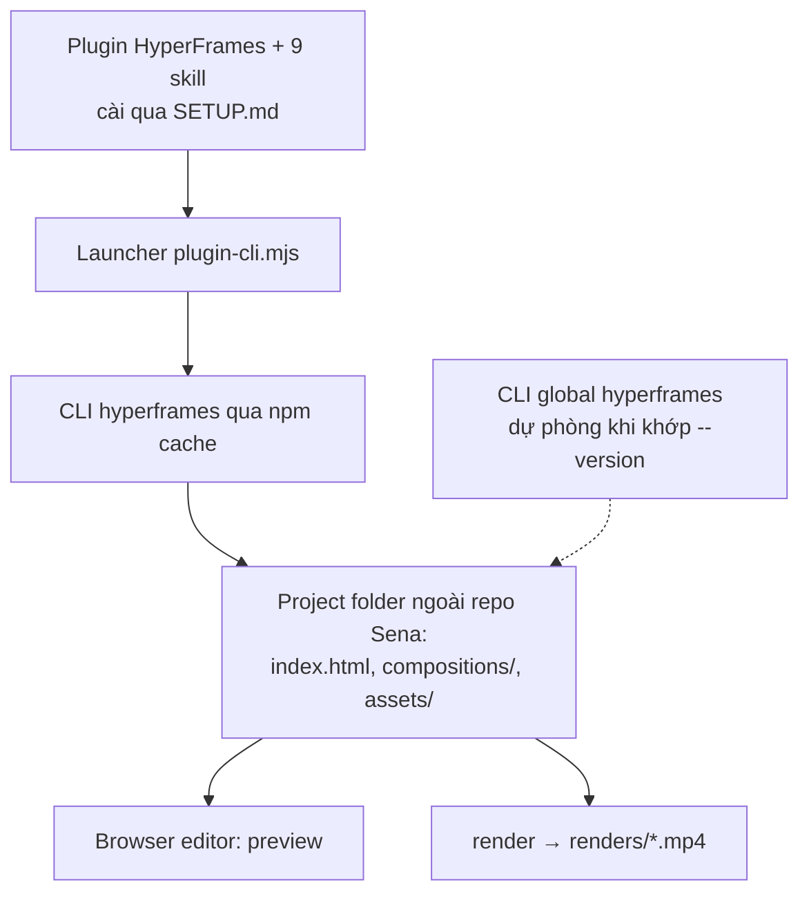

# HyperFrames — bộ Instruction tra cứu

**HyperFrames là công cụ dựng mặc định của Sena.** Bộ tài liệu này tổng hợp từ tài liệu chính thức `hyperframes.heygen.com` (135 trang theo `/_llms/docs.txt`), mã nguồn `heygen-com/hyperframes` và kiểm thử smoke cơ bản.

Trạng thái: **bộ tra cứu thực chiến có nguồn + kiểm thử smoke (init → lint → check → timeline → snapshot → preview → render → ffprobe và kho HeyGen miễn phí `credits: 0`)**. Các tính năng nâng cao (captions, remove-background, media-treatment, beats/audio, transcribe tiếng Việt, cloud/share) cần kiểm chứng theo từng dự án thật.

## Đọc gì khi nào

| Tình huống | Mở |
| --- | --- |
| Bắt đầu bất kỳ job HyperFrames | [[knowledge/hyperframes/02-quy-trinh-lam-viec]] (vòng làm việc + chọn loại video) |
| Chạy lệnh, launcher, môi trường, chi phí miễn phí vs trả phí | [[knowledge/hyperframes/01-setup-va-chi-phi]] |
| Viết/sửa HTML composition, lint báo lỗi | [[knowledge/hyperframes/03-composition-contract]] |
| Tra lệnh/flag, render format | [[knowledge/hyperframes/04-cli-reference]] |
| Footage, voice, nhạc, SFX, mix, captions, cutout, grade | [[knowledge/hyperframes/05-am-thanh-media-mau]] |
| Trước khi preview/render/giao | [[knowledge/hyperframes/06-qa-render-giao-file]] |
| Cần transition, caption style, lower third, chart, overlay | [[knowledge/hyperframes/07-catalog-registry]] |
| Viết SPEC, dịch feedback thành thay đổi, motion/ease, làm lại reference | [[knowledge/hyperframes/08-dao-dien-prompt]] |
| Có gì đó hỏng | [[knowledge/hyperframes/09-loi-thuong-gap]] |

## 10 điều không được quên

1. **Đọc Skill gốc trước khi làm:** mở skill `hyperframes` trong plugin đã cài và tài liệu tham chiếu đúng loại video; bộ tra cứu này áp vào quy chuẩn Senior editor, không thay thế skill gốc.
2. **Chạy CLI đúng phiên bản:** ưu tiên launcher `plugin-cli.mjs` của plugin (hoặc CLI `hyperframes` global nếu `--version` khớp); không tự chạy script `npm run` của project trừ khi người dùng yêu cầu. Skill vận hành: [[.agents/skills/hyperframes-sena/SKILL]].
3. **Câu hỏi / ý tưởng còn lỏng → trao đổi, đề xuất trước; không sửa file.** Phim > ~15 giây kể chuyện → 2–3 storyline bằng chữ để người dùng chọn, rồi viết `SPEC.md`.
4. **Dựng đúng yêu cầu:** không tự thêm voiceover/captions/tỷ lệ khung hình mới; mặc định `1920×1080 @ 30fps` (hoặc theo [[USER]]).
5. **Tra registry trước khi tự viết hiệu ứng phổ biến;** xử lý media qua `media-use`; số liệu/tuyên bố phải truy được về nguồn.
6. **Composition contract:** `class="clip"` + `data-start` + `data-duration`; root `data-duration` quyết định tổng độ dài; timeline paused đăng ký đúng key; hoàn toàn tất định; không điều khiển media bằng script tự do.
7. **Sau mỗi lần sửa:** `lint` → `check --json` → **`snapshot` và mở ảnh ra nhìn** (`check` pass không chứng minh chữ không đè nhau).
8. **Preview & Render theo [[USER]]:** mặc định mở preview gửi URL và **dừng chờ người dùng duyệt** (chỉ tự render khi người dùng yêu cầu hoặc bật tự render trong `USER.md`).
9. **Kiểm file xuất:** `ffprobe` khớp duration/W×H/fps/codec, xem frame giải mã, đo âm thanh; luôn ghi rõ phần âm thanh chỉ đo bằng máy chưa nghe trực tiếp.
10. **Cổng duyệt chi phí & tác động ngoài:** không tự đăng nhập HeyGen, tiêu credit, share/publish/cloud, nâng/hạ CLI/plugin hay cài tool nặng khi người dùng chưa đồng ý.

## Bề mặt làm việc

## Giới hạn và điểm cần lưu ý

- Tài liệu và CLI HyperFrames cập nhật rất nhanh; luôn chạy `--help` trước khi dùng lệnh hoặc flag mới. Số liệu gói Studio/giá/credit có thể thay đổi theo thời điểm.
- Một số điểm lệch giữa các trang docs gốc cần tự đối chiếu khi dùng: mặc định audio carve (0.25 vs 0.8), `video_missing_muted` error vs warning, cổng preview, cú pháp `.hyperframesignore`.
- Kokoro TTS cục bộ không hỗ trợ tiếng Việt.
- Tài liệu này là hướng dẫn thực hành có nguồn; chất lượng mỗi bản dựng luôn được kiểm chứng trực tiếp bằng kết quả xem và đo file xuất.
