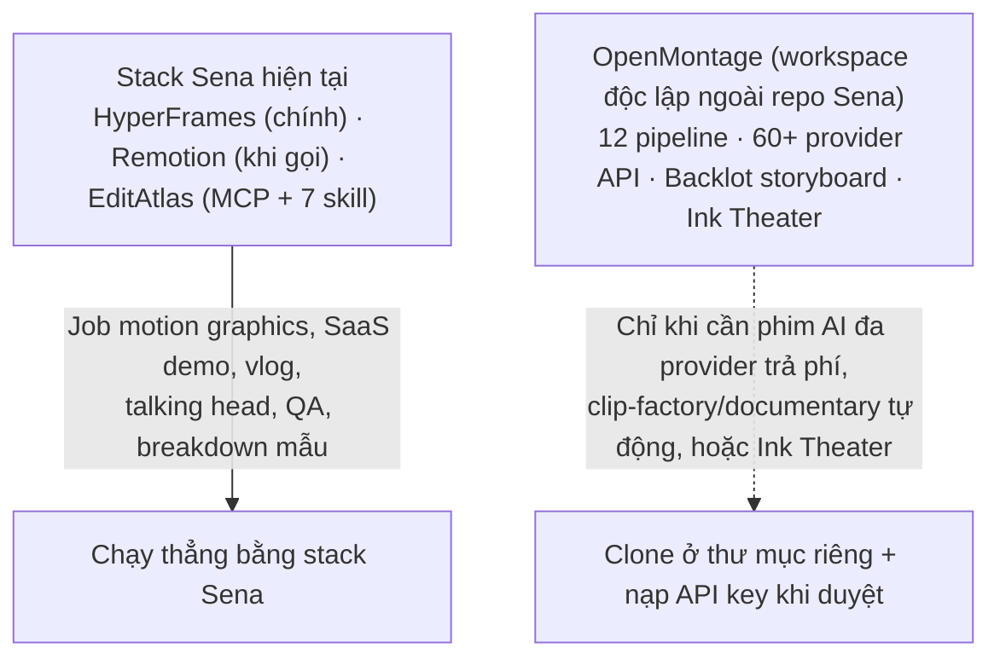

# OpenMontage — bộ Instruction đánh giá và tra cứu

Nguồn: `OpenMontageInc/OpenMontage` (license `AGPL-3.0`, HEAD `2e003e6`), tổng hợp trực tiếp từ `README.md`, `AGENTS.md`, `AGENT_GUIDE.md`, `Makefile`, `setup.py`, `requirements.txt`, `config.yaml`, `pipeline_defs/`, `skills/core/hyperframes.md`, `backlot/README.md`, `ink-theater/README.md`, `docs/PROVIDERS.md`, `docs/apple-silicon-mps.md`, `remotion-composer/package.json`.

Trạng thái: **chưa cài mặc định (tài liệu đánh giá tham khảo)**; mới đọc mã nguồn và tài liệu gốc, chưa chạy kiểm chứng trên job thật. **HyperFrames** là công cụ dựng mặc định; **Remotion** dùng khi yêu cầu; **EditAtlas** là lớp tri thức MCP + 7 skill bổ trợ.

## Kết luận nhanh

1. **Tồn tại dưới dạng gì?** **KHÔNG phải MCP, KHÔNG phải plugin Skill để gắn vào repo Sena, và KHÔNG phải CLI global.** OpenMontage là một **workspace/monorepo độc lập hoàn chỉnh** (chứa `AGENTS.md` riêng, 12 pipeline YAML, 141 file skill nội bộ, 100+ tool Python, `remotion-composer/`, `backlot/` web dashboard và `ink-theater/`). Nếu dùng thì phải `git clone` thành một thư mục riêng bên ngoài repo Sena rồi mở agent bên trong đó — **không trộn vào repo Sena**.
2. **Vì sao chưa cài mặc định?**
   - Hai engine dựng bên dưới của nó chính là **HyperFrames** và **Remotion** (`remotion-composer` pin `^4.0.484`) + FFmpeg — trùng mạnh với stack Sena đã có sẵn.
   - Thế mạnh nổi bật nhất của nó là **điều phối hàng chục API tạo ảnh/video/giọng đọc/nhạc trả phí** (Kling, Veo 3.1, Runway Gen-4, Seedance, FLUX, ElevenLabs, Suno…) kèm kiểm soát ngân sách và storyboard **Backlot**. Nếu chạy không nạp API key trả phí, giá trị gia tăng so với HyperFrames + EditAtlas không lớn.
   - Clone + `make setup` (`.venv` + `remotion-composer/node_modules` + Piper TTS) tốn thêm **~1,5–2 GB** dung lượng ổ cứng; và các model tạo video AI cục bộ thường yêu cầu **> 16 GB VRAM**.
3. **Khi nào ĐÁNG cài riêng?** Khi bạn làm **phim AI nhiều cảnh bằng API trả phí** (trailer, product film image-to-video, explainer có AI visual + voiceover + nhạc tự động), **làm documentary từ kho Archive/NASA/Wikimedia**, **cắt hàng loạt clip từ podcast/video dài (`clip-factory`)**, hoặc muốn dùng **Backlot** (bảng storyboard web theo dõi tiến độ + chi phí từng cảnh).

## Đọc gì khi nào

| Tình huống | Mở |
| --- | --- |
| Hình thức tồn tại, cấu trúc monorepo, 12 pipeline, Backlot, Ink Theater, yêu cầu máy, AGPL-3.0 và cách cài đúng nếu sau này cài | [[knowledge/openmontage/01-kien-truc-va-hinh-thuc-cai]] |
| So sánh với HyperFrames / Remotion / EditAtlas, ma trận tình huống nên/không nên dùng, chi phí và bài học kỹ thuật rút ra cho HyperFrames | [[knowledge/openmontage/02-so-sanh-va-tinh-huong-ung-dung]] |

## Vị trí tiềm năng của OpenMontage (nếu sau này bạn muốn dùng riêng)

## 8 điều không được quên

1. **Tuyệt đối không cài hoặc copy OpenMontage vào bên trong repo Sena:** `AGENTS.md` và 93+ skill trong `.agents/skills/` của nó sẽ xung đột trực tiếp với cấu hình và các plugin của Sena.
2. **Bản quyền `AGPL-3.0`:** dùng nội bộ để tạo file video thì video xuất ra không bị ràng buộc AGPL; nhưng **không được sao chép code/tool của OpenMontage vào ứng dụng/dịch vụ chạy cho người dùng mạng** đóng mã nguồn nếu không tuân thủ điều khoản mở mã nguồn AGPL-3.0.
3. **Yêu cầu máy tối thiểu:** Python 3.10+ (khuyến nghị `uv`), Node 22+, FFmpeg và ổ trống dư tối thiểu ~3–5 GB trước khi cài.
4. **Giới hạn phần cứng tạo video AI local:** phần lớn model tạo video cục bộ cần > 16 GB VRAM (máy 16 GB thống nhất hoặc GPU nhỏ không chạy vừa); muốn tạo video AI bằng OpenMontage cần dùng API trả phí (luôn xác nhận ngân sách và API key trước).
5. **Cơ chế khóa ngân sách (`config.yaml`):** mặc định `budget.mode: warn`, `total_usd: 10.00`, `single_action_approval_usd: 0.50` — nếu dùng thật nên đổi sang `mode: cap` để khóa trần cứng.
6. **Phiên bản Remotion tích hợp:** `remotion-composer` trong OpenMontage có thể cũ hơn plugin Remotion đang dùng ở Sena; luôn kiểm `package.json` trước khi so sánh tính năng.
7. **Kinh nghiệm kỹ thuật HyperFrames hữu ích rút ra từ repo này** (re-encode dense keyframe cho video stock, scale-to-cover tránh viền đen, `--workers 1` khi > 5 video nền, nhúng đủ file `.ttf` tránh bẫy subset font) — xem mục 3 của [[knowledge/openmontage/02-so-sanh-va-tinh-huong-ung-dung]].
8. **Giới hạn kiểm chứng:** toàn bộ nội dung tổng hợp từ mã nguồn/tài liệu gốc, chưa chạy thực nghiệm trên job thật.
