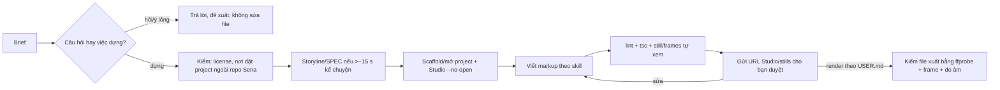

# Remotion — Quy trình làm việc của Sena

Nguồn: skill plugin `remotion-best-practices` (router), `remotion-create` (+ `video-layout.md`), `remotion-markup` (`SKILL.md`, `multi-scene-video.md`, `video-editing.md`, `compositions.md`), `remotion-interactivity`, `remotion-studio`, `remotion-render`; docs `ai/coding-agents`, `studio/*`, `render`; chuẩn cộng tác của [[AGENTS]] và [[ROLE]].

## 1. Chọn công cụ: HyperFrames hay Remotion

**HyperFrames là công cụ dựng mặc định; Remotion dùng khi người dùng yêu cầu hoặc khi bài toán cần thế mạnh của React/dữ liệu động.** Bảng tham khảo tiêu chí chọn Remotion:

| Dùng Remotion khi | Lý do (từ docs/repo) |
| --- | --- |
| Người dùng gọi tên Remotion, hoặc project/template đã là Remotion | Không tự chuyển công cụ giữa chừng |
| Cần component React/TypeScript tái sử dụng, design system video, props có schema | `<Composition>` + zod schema + Studio props editor → [[knowledge/remotion/06-data-server-cloud-app]] |
| Render hàng loạt từ dữ liệu (JSON/CSV/API), cá nhân hóa | `--props`, `calculateMetadata`, `@remotion/renderer`, Lambda/Vercel |
| Nhúng video tương tác vào web/app (`<Player>`), editor riêng | `@remotion/player`, Editor Starter, Timeline |
| Cần package riêng: bản đồ (`remotion-maps`), captions kiểu TikTok, `@remotion/transitions`, Lottie/Three/Skia, light leaks, motion blur, effects | → [[knowledge/remotion/03-markup-animation]], [[knowledge/remotion/04-media-am-thanh-captions]] |
| Cần xuất timeline sửa tiếp trong DaVinci/Premiere | `remotion-render/opentimeline.md` (OpenTimelineIO) |

Nếu người dùng chưa chọn Remotion → mặc định dựng bằng HyperFrames; nếu thấy bài toán hợp Remotion hơn thì nêu rõ 2 lựa chọn + đánh đổi để người dùng quyết. Chuyển project Remotion sang HyperFrames: skill `remotion-to-hyperframes` của plugin HyperFrames.

## 2. Vòng làm việc

1. **Đọc skill gốc trước khi làm:** `remotion-best-practices` (router) → skill con đúng việc. Tra API mới nhất bằng `remotion-docs` hoặc thêm `.md` vào URL docs.
2. **Kiểm tra đầu vào trước khi dựng:** xác nhận điều kiện license nếu làm cho công ty > 3 người ([[knowledge/remotion/01-setup-license-phien-ban]] §4); chọn thư mục đặt project **ngoài repo Sena**.
3. **Định hình:** phim > ~15 giây có kể chuyện → 2–3 storyline bằng chữ để người dùng chọn rồi mới viết code. Build đúng cái được yêu cầu: không tự thêm voiceover/captions/nhạc/aspect mới. Mặc định của scaffold là `1280×720@30` — đổi theo mục tiêu (`1920×1080`, `1080×1920`…).
4. **Scaffold** theo `remotion-create`: thư mục rỗng → `npx create-video@latest --yes --blank --no-tailwind .`; thư mục có nội dung → thư mục con. Thêm package bằng `npx remotion add`.
5. **Mở Studio trước khi viết:** `npx remotion studio --no-open` (in URL cục bộ, tránh tự mở trình duyệt cá nhân). Gửi URL để người dùng tự mở; Sena tự kiểm bằng ảnh still/frames.
6. **Viết markup** theo `remotion-markup` + `video-layout.md`: mỗi scene một component; scene nối tiếp dùng `TransitionSeries`, scene có start độc lập dùng `Track`; timeline nhiều clip footage theo `video-editing.md`; markup mặc định editable trong Studio (`remotion-interactivity`: `Interactive.*`, schema, giá trị inline).
7. **Tự kiểm sau mỗi lần sửa:** `npm run lint` (eslint + tsc) → `npx remotion compositions` → `npx remotion render <id> out/frames --frames=<đầu,giữa các beat,cuối> --image-format=png` và **mở ảnh ra nhìn**. Lint sạch không chứng minh layout đúng (chữ đè, tràn safe area, font fallback mất dấu).
8. **Dừng duyệt hoặc Render theo [[USER]]:** mặc định gửi URL Studio + ảnh stills để người dùng duyệt hoặc tự bấm Render trong Studio.
9. **Render file giao** khi người dùng yêu cầu hoặc bật tự render trong [[USER]]: luôn truyền composition ID; props qua `--props`; `--license-key=free-license` (nếu đủ điều kiện Free) hoặc key hợp lệ, `--is-production=false` cho bản thử. Chi tiết flag/preset: [[knowledge/remotion/05-studio-cli-render]].
10. **Kiểm bản giao** (§4) rồi báo rõ: đường dẫn file, thông số đo được, mục đã/chưa kiểm.

## 3. Quy tắc viết markup quan trọng nhất

- Mọi chuyển động là hàm của `useCurrentFrame()` + `interpolate()`/`spring()`/`Easing.*`; CSS `transition`/`animation`/class animate của Tailwind **không render đúng**.
- `useCurrentFrame()` đặt ở component nhỏ nhất cần nó; giây → frame luôn qua `fps` từ `useVideoConfig()`, viết inline trên JSX (`from={2 * fps}`) để Studio sửa được và đúng khi đổi fps.
- Ưu tiên CSS `scale`/`translate`/`rotate` thay `transform`; scale animation dùng `output: 'perceptual-scale'`.
- Tất định: không `Math.random()`/`Date.now()`/fetch không chờ — dùng `random(seed)`, `useDelayRender()`.
- Asset trong `public/` qua `staticFile()`; font qua `@remotion/google-fonts` (khai `subsets` có `vietnamese`) hoặc `@remotion/fonts` cho font local.
- Layout video, không phải trang web: mỗi scene một điểm nhìn chính; safe area ≥ 80 px hai bên, ≥ 100 px trên/dưới ở khung rộng 1080; headline ≥ 84 px, chữ phụ quan trọng ≥ 44 px (scale theo width).
- Người dùng có thể sửa code ngoài hội thoại → thấy thay đổi lạ thì giữ nguyên hoặc hỏi, không tự ghi đè.

Luật đầy đủ: [[knowledge/remotion/03-markup-animation]].

## 4. Chuẩn kiểm bản giao

| Kiểm | Cách |
| --- | --- |
| Thông số | `ffprobe` (hoặc `npx remotion ffprobe`): duration = `durationInFrames / fps`, W×H, fps, codec, pix_fmt, có/không audio stream đúng ý |
| Hình | Xem frame giải mã ở các beat (still/`--frames` hoặc ffmpeg trích frame từ file xuất), đặc biệt chữ tiếng Việt, safe area, frame đầu/cuối |
| Âm | Đo loudness/peak bằng ffmpeg nếu có âm; nói rõ "đã đo bằng máy, chưa nghe trực tiếp" |
| Alpha | ProRes 4444 / WebM alpha: pix_fmt có `a` |
| Dữ kiện | Số liệu/lời trích trên màn hình truy được về nguồn người dùng cung cấp |

Render thành công ≠ đạt chất lượng; người dùng là người nghiệm thu cuối cùng.

## 5. Không tự làm (cần người dùng duyệt trước)

Mua/nhập license, deploy Lambda/Vercel/Cloud Run hoặc dùng tài khoản cloud, API key trả phí (OpenAI, ElevenLabs, Mapbox, Google Map Tiles), nâng version project/plugin (`remotion upgrade`, `remotion-upgrade`), cài Element từ URL ngoài `remotion.dev`, tự mở browser cá nhân, publish/share. Không chép key vào code commit.
